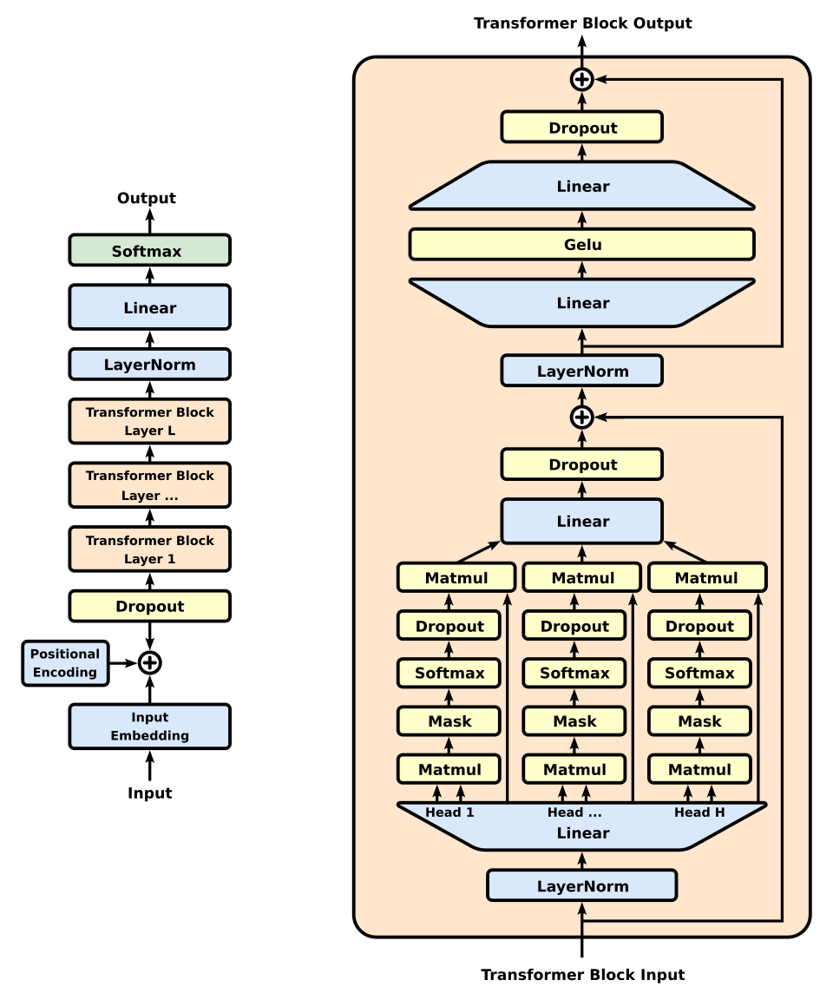

# Decoder-only 架构

> Llama、DeepSeek、Qwen 等主流 LLM 都是 Decoder-only。本文讲模型结构与训练，按"核心思路 → 模型结构 → 训练"展开；推理流程（Prefill / Decode、KV Cache、GPU 与 CPU 分工、并行策略）见 `inference.md`。

## 1. 核心思路

Decoder-only 把所有任务统一成一件事：**给定前缀，预测下一个 token**。

- prompt 只是已知的前缀，生成就是不断往后续写；prompt 与生成内容是**同一条序列**；
- 注意力始终是因果的（Masked Self-Attention）：位置 i 只能看到 ≤ i 的 token；
- 结构简单、易于扩大规模，推理时只需维护一份 KV Cache。

## 2. 模型结构



*图：GPT（Decoder-only）完整架构。左：整体结构；右：单个 Block 的展开，Pre-Norm（LayerNorm 在子层之前），Attention 子层内每个 head 做 Matmul → Mask → Softmax → Matmul，随后是 Linear 输出投影（W_O），FFN 子层为 Linear → GELU → Linear，两个子层各有残差连接。来源：[Wikimedia Commons](https://commons.wikimedia.org/wiki/File:Full_GPT_architecture.svg)（CC0）。该图是 GPT-2 风格（LayerNorm、GELU、Dropout），现代 Llama 类模型的差异见 2.2。*

### 2.1 整体流程

```
采样（temperature / top-k / top-p）→ 下一个 token
   ▲
   │
LM Head (Linear)               d_model → vocab，得到 logits
   ▲
   │
Final Norm
   ▲
   │
┌─────────────────────┐
│  Decoder Block × L   │      L 层结构相同、参数各自独立
└─────────────────────┘
   ▲
   │
Embedding                      查表：token id → d_model 维向量
   ▲
   │
token ids
```

- **Embedding**：把离散的 token id 映射成连续向量，是模型的入口。
- **位置信息**：早期模型把 Positional Encoding 加在输入上（如图）；现代模型多用 RoPE，在每一层 Attention 内对 Q、K 做旋转，输入端不再加位置编码。
- **Final Norm + LM Head**：只在最后出现一次。LM Head 是一个大线性层（`[d_model, vocab]`），把 hidden state 映射到词表维度，得到每个候选 token 的分数 logits。softmax 通常不对全词表计算：先经 temperature / top-k / top-p 过滤，再对候选归一化采样。LM Head **不属于 FFN**。每个 Decode 步都要执行 `[batch, d_model] × [d_model, vocab]` 这个大 GEMM，是采样阶段的主要开销。
  - **Position-wise**：LM Head 是一次矩阵乘法 `logits = hidden @ W_lm`（通常无 bias），输入 `[N, d_model]`、输出 `[N, vocab]`；每个位置的 hidden state 独立乘同一个 `W_lm`，位置之间互不依赖，可与 batch 合并一次算完。
  - **训练 vs 推理**：训练时每个位置都要算 logits 和 loss，整条序列都过 LM Head（`[N, vocab]` 很大，是显存热点，常分块计算 loss）；推理时只需**最后一个位置**的 logits 来采样，Prefill 阶段引擎通常只对最后一个位置做 LM Head，省掉其余 N-1 个位置的计算，Decode 时 N=1。
  - **权重共享**：部分模型（多见于小模型）让 LM Head 与 Embedding 共享权重（tied embeddings，转置复用），省一份 `vocab × d_model` 参数。

**$d_{model}$ 与 vocab 的典型取值**（大致量级，具体以各模型官方 config 为准）：

| 模型 | $d_{model}$ | vocab |
| --- | --- | --- |
| GPT-2 small | 768 | 50257 |
| Llama-2 7B | 4096 | 32000 |
| Llama-3 8B | 4096 | 128256 |
| Qwen2.5-7B | 3584 | 约 15.2 万 |
| Llama-3 70B / Qwen2.5-72B | 8192 | 12.8 万 / 约 15.2 万 |
| Llama-3.1 405B | 16384 | 128256 |
| DeepSeek-V3（MoE） | 7168 | 129280 |

- $d_{model}$ 是模型"宽度"，随规模增长（小模型 768~2048，7B~8B 约 3584~4096，70B 约 8192，400B 以上约 1.6 万），通常取 128 的倍数；它与层数 L 共同决定参数量，FFN 中间维度也随之缩放。MoE 模型的参数主要靠 Expert 数量堆出，$d_{model}$ 不一定大。
- vocab 随分词器与语种覆盖变化，趋势是越来越大（经典 Transformer 约 2 万，现代 LLM 3 万到 15 万以上）：多语言、中文覆盖更好，同样文本所需 token 更少，代价是 Embedding 与 LM Head 的参数和计算变大。
- 例：Llama-3 8B 的 LM Head 为 $4096 \times 128256$，约 5.3 亿参数，约占总参数的 6.5%。

### 2.2 单个 Decoder Block

现代模型通常使用 **Pre-Norm**（常用 RMSNorm），一个 Block 的计算为：

```
h   = x + Attention(Norm(x))      # Attention 子层 + 残差
out = h + FFN(Norm(h))            # FFN 子层 + 残差（FFN 的输入是 Norm(h)）
```

注意 FFN 的输入不是 Attention 的原始输出，而是**加残差再 Norm** 之后的结果。

**术语**：**hidden state** 指层与层之间流动的 `[N, d_model]` 张量（残差流），通常特指每个 Block 的输出 `out`；`x`、`h` 也是残差流上的快照。子层自身的输出（`Attention(Norm(x))`、`FFN(Norm(h))`）只是加到残差流上的增量，一般称 attention output / FFN output，加上残差后才是 hidden state。`h` 是本文为公式方便起的名字，不是标准术语；不同代码库里 `hidden_states` 的含义可能不同（如 attention 模块里指其输入）。

两个子层的经典形态与现代常见形态：

| 子层 | 经典形态 | 现代常见形态 |
| --- | --- | --- |
| Attention | Multi-Head Attention（MHA） | GQA（多个 Q head 共享一组 KV）、MLA（共享压缩的 latent KV） |
| FFN | 两层线性 + ReLU/GELU | SwiGLU；大模型常把 FFN 替换成 MoE（多套 Expert + Router） |

Attention 的变体直接决定 KV Cache 的大小和并行方式（MLA 与 TP 的矛盾见 `dp_attention.md`），FFN 换成 MoE 则引出 Expert Parallel（见 `dpa_ep.md`、`moe.md`）。

**哪些操作 token 间有依赖**：Block 内只有 Attention 核心（$QK^\top$ 与对 V 的加权求和）让 token 之间互相依赖；其余操作（Q/K/V 投影、输出投影 $W_O$、FFN、Norm，以及 Block 之外的 LM Head）都是 Position-Wise，即每个 token 用相同参数独立计算，可以按 token 任意切分。

### 2.3 Attention 详解

**作用**：让每个 token 根据自身需要，从可见的上下文（前文 token）中**选择性地收集信息**，融入自己的表示。

- 按相关性动态取信息，既不是平均，也不是固定窗口。例如"它"可以把权重集中在前文所指代的名词上。
- Attention 是 Block 中**唯一**让 token 之间交换信息的地方，负责**汇集**上下文；"加工"与知识存储由 FFN 完成（见 2.4），"理解"是两者多层配合的结果。多层堆叠后，上下文信息逐层累积、抽象。
- 因果注意力只能看**前文**，即"从已有前缀理解信息，用来预测下一个 token"。前文 token 的 K、V 不会再变，这正是 KV Cache 成立的原因：Decode 时只需新 token 的 Q 去查缓存里的 K、V。

**计算过程**：每个 token 经 Q、K、V 三个线性变换得到自己的 Q、K、V；用自己的 Q 与所有**可见**（受 Causal Mask 限制）的 K 计算 attention 权重，再用权重对相应的 V 加权求和，得到该 token 的输出。

**多头与输出投影 $W_O$**：以 $d_{model}=512$、8 个 head、每个 head 64 维为例：

1. 8 个 head 并行计算，每个 head 为每个 token 输出一个 64 维向量；
2. 在特征维上拼接（concat）为 $8 \times 64 = 512$ 维，concat 只是内存上的拼接，不涉及乘法；
3. 经输出投影 $W_O$（`nn.Linear(n_heads * d_v, d_model)`，此例为 $512 \times 512$）做一次矩阵乘法。

$W_O$ 让每个输出维度综合利用所有 head 的特征，起到**融合**作用，而不是升降维：此例输入输出都是 512 维，$d_{model}$ 不变。常见配置是 $n_{heads} \times d_v = d_{model}$；若不相等，$W_O$ 负责把拼接维度映射回 $d_{model}$。$W_O$ 属于 Attention 模块，**不属于 FFN**。

**Causal Mask 与 FlashAttention**：Causal Mask 把未来位置设为不可见，只限制可见性，不限制计算并发。理论上标准实现会算出约一半最终被 Mask 掉的 $QK^\top$ 结果；FlashAttention 等现代实现通过 kernel fusion、分块（blocking）和 online softmax，既不显式生成完整的 Attention Matrix，也按 block 跳过上三角区域，实际浪费远小于理论值。

### 2.4 Position-Wise FFN

对每个 token 位置，使用同一组 FFN 参数独立变换，token 之间没有信息交换；参数量与序列长度无关。每个 Block 里有一个 FFN（Llama 等为 SwiGLU），L 层就有 L 个 FFN。

**维度变化**：FFN 内部先升到中间维度（经典 FFN 约 $4d_{model}$，SwiGLU 常用约 $\frac{8}{3}d_{model}$ 或更大），再降回 $d_{model}$。因此 Block 的输入输出都是 `[N, d_model]`，层与层之间可以直接堆叠。

**为什么能存储知识**：Attention 只是对上下文里**已有** token 的 V 做加权重组，上下文里没出现过的事实（如"法国的首都是巴黎"）必须来自参数，而参数主要在 FFN 里。这是研究中的主流解释（Geva et al., 2021），不是严格证明的定论。

- **key-value 记忆**：FFN 为 $W_{down}\,\mathrm{act}(W_{up}\,x)$。$W_{up}$ 的每一行是一个 key（模式探测器），与输入 x 点积衡量匹配度；激活函数把匹配度变成稀疏的"开关"；$W_{down}$ 的对应列是 value，被激活的神经元把各自的 value 加权写回 hidden state。即"检测到某种模式 → 写入某些信息"。
- **参数占比**：标准 Block 中 Attention 约 $4d^2$ 参数，FFN（中间维度 4d）约 $8d^2$，占约 2/3，是模型容量的主要载体。
- **实验证据**：知识编辑研究（如 ROME）发现事实性知识主要集中在中间层 FFN；单个神经元常对应可解释的模式。
- **注意**：知识是**分布式**存储的（存在叠加现象），不是一个事实对应一个神经元；Attention 也参与知识的提取（如把主语信息搬到当前位置供 FFN 查询）。更准确的说法是：**FFN 是知识的主要存储位置，Attention 负责把查询所需的信息送到位**。

**通向 MoE**：当模型规模增长、参数主要堆在 FFN 上时，一个自然的扩展是准备多套 FFN 参数（Experts），由 Router 根据每个 token 的 hidden state 选择其中几套计算。这就是 MoE 的出发点（见 `moe.md`）。

### 2.5 张量形状：N 与 batch

文中 `[N, d_model]` 的 N 是**单条序列**的 token 数：训练时为整条序列长度，Prefill 时为 prompt 长度，Decode 时每步为 1。实际框架里还有 batch 维，形状为 `[B, N, d_model]`。

- Position-wise 算子（FFN、Norm、QKV 投影等）对 token 一视同仁，可把 B 与 N 合并成 `[B·N, d_model]` 一次大 GEMM 算完，只有 token 总数重要。
- Attention 核心例外：token 只能与**同一条序列**的前文交互，序列之间必须隔开。
- 推理引擎（vLLM、SGLang 等）通常用 continuous batching，直接把多条序列的 token 拼成 `[总 token 数, d_model]`，不做 padding；同一 batch 可混有 Prefill（N 大）与 Decode（N=1）的序列。

## 3. 训练

**数据组织**：把输入和输出拼成**同一条序列**，一次前向送入（Teacher Forcing）；标签就是这条序列错开一位，位置 i 预测第 i+1 个 token：

```
序列:    x1   x2   x3   x4   x5
输入:    x1   x2   x3   x4          ← 取前 n-1 个
标签:         x2   x3   x4   x5     ← 取后 n-1 个
```

- **并发**：每层把整条序列作为一个大矩阵 `[N, d_model]` 一次算完；Causal Mask 保证位置 i 看不到 i 之后的 token，不会偷看答案。一次前向得到 n-1 个训练信号。
- **损失**：每个位置的 logits 与下一个 token 求交叉熵，所以**每个位置**都要过 LM Head。预训练时每个位置都算 loss；指令微调（SFT）时通常用 loss mask 屏蔽 prompt 部分，只对回答部分算 loss（prompt 位置只当上下文）。
- **反向传播**：需要保存激活值；不需要 KV Cache（整条序列一次算完，用完即丢）。

## 4. 从训练到推理

训练时整条序列（输入加输出）一次送入，所有位置并发算完；推理时后面的 token 还没生成，必须先用 **Prefill** 处理 prompt，再用 **Decode** 逐 token 续写，并借助 KV Cache 避免重复计算。这部分见 `inference.md`。
