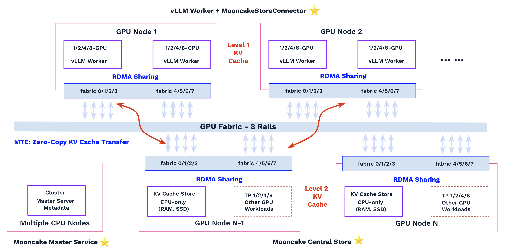
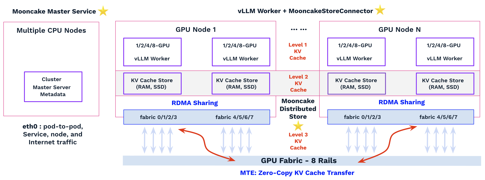

# KV Cache Sharing with vLLM and MooncakeStoreConnector on DOKS

Follow [amd-mn-k8s-environment](https://github.com/rxsalad/multi-node-solutions/blob/main/amd-mn-k8s-environment.MD) and [amd-mn-k8s-rdma-sharing.MD](https://github.com/rxsalad/multi-node-solutions/blob/main/amd-mn-k8s-rdma-sharing.MD) to prepare the environment before proceeding. The setup requires two DOKS workers with 16 GPUs and RDMA/RoCE support. Ensure that Multus CNI, ipvlan CNI, and Whereabouts IPAM CNI are installed and configured.

This guide provides a step-by-step walkthrough for deploying KV cache sharing with vLLM and the MooncakeStoreConnector on DOKS. Using an RDMA-enabled infrastructure, multiple vLLM workers across DOKS nodes can publish and retrieve cached KV blocks through [a centralized or distributed Mooncake store](https://kvcache-ai.github.io/Mooncake/design/mooncake-store.html#architecture). This architecture enables efficient KV cache sharing across workers, reduces redundant prompt prefill computation, improves GPU utilization, and lowers TTFT for requests with shared prompt prefixes.

See [mc-pdd-doks-amd.MD](mc-pdd-doks-amd.MD#vllm-mooncake-integration) for a guide to deploying Prefill–Decode (PD) Disaggregation with vLLM and MooncakeConnector. KV cache sharing and transfer with PD Disaggregation will be covered in a separate guide.

## Store Deployment Options

**Centralized Store** – Dedicated Mooncake Store services manage the shared KV cache pool. vLLM workers act as clients, enabling independent scaling and optimization of storage and inference.

**Distributed Store** – Each vLLM worker embeds a Mooncake Store and contributes local CPU memory to the shared KV cache pool. It simplifies deployment but couples compute and storage scaling.

**Hybrid Store** – Combines centralized and distributed stores, balancing scalability and flexibility with added deployment complexity.

## Centralized Store

A Centralized Store deployment uses one or more dedicated Mooncake Store services to own and manage the shared KV cache pool for all vLLM workers. The vLLM workers act solely as clients and access the store through MooncakeStoreConnector over MTE.

The centralized architecture separates storage resources from inference resources, enabling independent deployment, scaling, and optimization of the storage and compute components. The store is responsible for storage allocation, object metadata management, and serving KV cache requests.

### Architecture

The system consists of the following key components:



#### Master Service and Metadata Service

The Master Service is an independent process responsible for managing the cluster's logical storage pool, including node membership, object allocation, and storage metadata. It maintains the mapping between objects and their physical storage locations, allowing clients to locate KV cache objects and other stored data. The Master Service is optimized for LLM inference workloads and exposes RPC APIs for external components.

The Metadata Service is used by MTE for peer discovery and configuration. It stores runtime metadata such as node identities, network information, and RDMA endpoint information, allowing MTE instances to discover peers and establish RDMA connections. The Metadata Service can be backed by etcd, Redis, or an HTTP service. For simple deployments, the Master's embedded HTTP metadata server can replace an external Metadata Service. Alternatively, P2PHANDSHAKE enables decentralized peer discovery by exchanging and storing endpoint metadata locally on each node, eliminating the need for a centralized Metadata Service.

The Metadata Service is part of the MTE connection management path, but it is not part of the KV cache data transfer path. After the Master Service returns the location of a KV cache object, the client communicates directly with the target peer through MTE. Once RDMA connections are established, KV cache transfers occur directly between peers without involving either the Master Service or Metadata Service.

Both the Master Service and Metadata Service communicate over the pod's eth0 network and do not require access to GPUs or RDMA/RoCE devices. For production deployments, multiple Master Service instances can be configured as a highly available cluster with persistent storage.

``` Bash
# CPU Pod: Mooncake Master Service with embedded HTTP Metadata Service
# IP on eth0: 10.119.2.107

# mooncake_master --port 50051 \
  --enable_http_metadata_server=true \
  --http_metadata_server_host=0.0.0.0 \
  --http_metadata_server_port=8080
```

#### Dedicated Store Service

A dedicated Mooncake Store Service (or a small cluster of dedicated store services) owns and manages the shared memory pool for all vLLM workers. The store service registers with the Mooncake Master Service and Metadata Service to provide storage resources and metadata management.

The store service acts as a storage provider only, and there are no local vLLM workers that directly access the store through Store API operations such as Put() and Get(). Instead, all KV cache transfers are performed remotely by the Mooncake Transfer Engine (MTE) over RDMA/RoCE.

``` Python
# CPU Pod with RDMA/RoCE access: Mooncake Store

# cat mooncake_config.json 
from mooncake.store import MooncakeDistributedStore
store = MooncakeDistributedStore()
store.setup(
    local_hostname="central-store1",
    metadata_server=f"http://10.119.2.107:8080/metadata",
    master_server_addr=f"10.119.2.107:50051",
    global_segment_size=128 * 1024 * 1024 * 1024, # 128 GiB CPU Memory contributed to the storage pool
    local_buffer_size=4 * 1024 * 1024 * 1024,
    protocol="rdma",
    rdma_devices="",
)
print(f"Store is running (master={master_ip})...")

try:
    while True:
        time.sleep(60)
except KeyboardInterrupt:
    print("Stopping...")

# Run as a dedicated store service
# MC_TE_METRIC=1 \
  MC_ENABLE_DEST_DEVICE_AFFINITY=1 \
  python store.py
```

#### Dedicated vLLM Worrker

The vLLM workers act solely as inference clients and do not contribute storage resources.

Through MooncakeStoreConnector, they store and retrieve KV caches from the dedicated Mooncake store. MTE handles KV cache metadata management and transfers KV cache data between the dedicated store service and vLLM workers.

``` Python
# GPU Pod with RDMA/RoCE access: vLLM with MooncakeStoreConnector
# Master IP: 10.119.2.107

# cat mooncake_config.json 
{
  "mode": "standalone-store",
  "metadata_server": "http://10.119.2.107:8080/metadata",
  "master_server_address": "10.119.2.107:50051",
  "local_buffer_size": "4GB",
  "protocol": "rdma",
  "device_name": ""
}

# MOONCAKE_CONFIG_PATH=mooncake_config.json \
  MC_ENABLE_DEST_DEVICE_AFFINITY=1 \
  vllm serve Qwen/Qwen3-8B \
    --no-enable-prefix-caching \
    --tensor-parallel-size 4 \
    --host 0.0.0.0 \
    --port 8000 \
    --kv-transfer-config '{"kv_connector":"MooncakeStoreConnector","kv_role":"kv_both"}' 
```

#### How It Works

On vLLM workers, the input prompt is divided into fixed-size blocks (for example, 16 or 32 tokens per block). Each block is assigned a hash that incorporates both the current block's token IDs and the hash of the previous block. This creates a hash chain where each hash uniquely represents the complete prompt prefix up to that block.

```
H0 = hash(Block0)
H1 = hash(H0 || Block1)
H2 = hash(H1 || Block2)
......
```

Each hash serves as the lookup key for its corresponding KV cache block.

When processing a new request, vLLM generates a hash chain for the input prompt and searches for matching KV cache blocks in both the local vLLM prefix cache and the Mooncake Store. Matching hashes indicate that the associated KV cache blocks are available for reuse, while only the unmatched suffix of the prompt needs to be recomputed during prefill.

If multiple matching prefixes are available, the system selects the longest prefix match based on prefix length, independent of whether the KV blocks reside locally or in the remote Mooncake Store. This approach maximizes KV cache reuse and avoids unnecessary prompt recomputation. When the longest match is found in the Mooncake Store, MTE performs the data transfer to GPU VRAM, enabling the vLLM worker to reuse the cached KV blocks directly.

After the request completes, the generated KV cache can be stored back into the store, allowing future requests with the same prompt prefix to reuse the cached KV blocks.

With prefix caching enabled, vLLM keeps KV cache entries locally after request completion so that future requests with the same prefix can reuse them. These entries may be evicted under the following conditions:

- GPU memory pressure: vLLM requires GPU memory for new requests and evicts existing KV cache entries.
- LRU eviction: KV blocks that have not been accessed recently are prioritized for eviction.
- Process restart or shutdown: The in-memory prefix cache is cleared when the vLLM engine exits.

When Mooncake is used as an external KV cache layer, eviction from GPU memory does not necessarily mean the KV cache is lost. If the same prefix is requested again, Mooncake can restore the KV cache back to GPU memory, avoiding full recomputation of the prompt prefix.


### Implementation

Refer to [sharing/mc-sharing-centralized-store.yaml](sharing/mc-sharing-centralized-store.yaml) for the details. It provisions one Mooncake master CPU pod and one dedicated store CPU pod with exclusive RDMA/RoCE access on one DOKS worker node (assuming no other applications share these resources). It also provisions two 4-GPU vLLM worker pods that share RDMA/RoCE access on another DOKS worker node.

The deployment uses two wrapper scripts:

- [sharing/store.py](sharing/store.py) retrieves the Mooncake Master IP address, registers the store with the Mooncake Master Service and Metadata Service, and runs it as a dedicated store service. The script uses the vLLM-based container image to avoid separately installing the required RDMA/RoCE libraries, although vLLM itself is not required by the dedicated store service.

- [sharing/worker.py](sharing/worker.py) retrieves the Mooncake Master IP address, generates the mooncake_config.json file, and then starts the vLLM worker instance with the appropriate Mooncake configuration.

The [MC_ENABLE_DEST_DEVICE_AFFINITY](https://kvcache-ai.github.io/Mooncake/design/transfer-engine/index.html#advanced-runtime-options) environment variable is enabled for both the store and vLLM workers to avoid the cross-rail connections while preserving per-rail parallelism.

vLLM prefix caching is disabled on the worker pods to evaluate the performance of the external KV cache provided by the Mooncake store.

``` bash
kubectl create configmap rs-store-script --from-file=sharing/store.py
kubectl describe configmap rs-store-script
kubectl delete configmap rs-store-script

kubectl create configmap rs-worker-script --from-file=sharing/worker.py
kubectl describe configmap rs-worker-script
kubectl delete configmap rs-worker-script

kubectl apply -f sharing/mc-sharing-centralized-store.yaml 
kubectl delete -f sharing/mc-sharing-centralized-store.yaml 
```

### Validation and Testing

Assuming the deployment is running, use kubectl exec to access the pods and perform testing and benchmarking.

``` bash
# kubectl get nodes -o wide
NAME                          STATUS   ROLES    AGE   VERSION   INTERNAL-IP   EXTERNAL-IP       OS-IMAGE                       KERNEL-VERSION        CONTAINER-RUNTIME
rs-mn-cpu-power-pool-3crqkh   Ready    <none>   19d   v1.34.1   10.118.0.8    165.22.238.61     Debian GNU/Linux 13 (trixie)   6.12.48+deb13-amd64   containerd://1.7.28
rs-mn-mi325x8-pool-3c35jt     Ready    <none>   27d   v1.34.1   10.118.0.6    138.197.135.192   Debian GNU/Linux 13 (trixie)   6.12.48+deb13-amd64   containerd://1.7.28
rs-mn-mi325x8-pool-3cmiju     Ready    <none>   24d   v1.34.1   10.118.0.7    167.99.176.197    Debian GNU/Linux 13 (trixie)   6.12.48+deb13-amd64   containerd://1.7.28

# kubectl get pods -o wide
NAME                 READY   STATUS    RESTARTS   AGE   IP             NODE                          NOMINATED NODE   READINESS GATES
mc-central-store-0   1/1     Running   0          78s   10.119.1.75    rs-mn-mi325x8-pool-3cmiju     <none>           <none>
mc-master-0          1/1     Running   0          78s   10.119.2.107   rs-mn-cpu-power-pool-3crqkh   <none>           <none>
mc-worker-0          1/1     Running   0          78s   10.119.0.165   rs-mn-mi325x8-pool-3c35jt     <none>           <none>
mc-worker-1          1/1     Running   0          73s   10.119.0.209   rs-mn-mi325x8-pool-3c35jt     <none>           <none>
```


The first run is handled by mc-worker-0, with an external prefix cache hit rate of 0.0% and an FFFT of 1109.94 ms.

``` bash
# NodePort - 167.99.176.197:30080
# vllm bench serve --host 167.99.176.197 --port 30080 --seed "1" \
        --backend vllm --model "Qwen/Qwen3-8B"  \
        --dataset-name random --random-input-len 32768 --random-output-len 128\
        --num-prompts 1 --burstiness 1 --request-rate 1 | tee benchmark.log

============ Serving Benchmark Result ============
Successful requests:                     1         
Failed requests:                         0         
Request rate configured (RPS):           1.00      
Benchmark duration (s):                  2.54      
Total input tokens:                      32768     
Total generated tokens:                  128       
Request throughput (req/s):              0.39      
Output token throughput (tok/s):         50.30     
Peak output token throughput (tok/s):    124.00    
Peak concurrent requests:                1.00      
Total token throughput (tok/s):          12928.11  
---------------Time to First Token----------------
Mean TTFT (ms):                          1109.94   
Median TTFT (ms):                        1109.94   
P99 TTFT (ms):                           1109.94   
-----Time per Output Token (excl. 1st token)------
Mean TPOT (ms):                          3.41      
Median TPOT (ms):                        3.41      
P99 TPOT (ms):                           3.41      
---------------Inter-token Latency----------------
Mean ITL (ms):                           3.52      
Median ITL (ms):                         3.56      
P99 ITL (ms):                            4.00      
==================================================

# Server logs: mc-worker-0
(APIServer pid=1) INFO 07-13 23:54:02 [loggers.py:271] Engine 000: Avg prompt throughput: 2.1 tokens/s, Avg generation throughput: 32.4 tokens/s, Running: 0 reqs, Waiting: 0 reqs, GPU KV cache usage: 0.0%, Prefix cache hit rate: 0.0%, External prefix cache hit rate: 0.0%
```

The second run is handled by mc-worker-1, with an external prefix cache hit rate of 50.0% and an FFFT of 361.40 ms.

``` bash
# vllm bench serve --host 167.99.176.197 --port 30080 --seed "1" \
        --backend vllm --model "Qwen/Qwen3-8B"  \
        --dataset-name random --random-input-len 32768 --random-output-len 128\
        --num-prompts 1 --burstiness 1 --request-rate 1 | tee benchmark.log

============ Serving Benchmark Result ============
Successful requests:                     1         
Failed requests:                         0         
Request rate configured (RPS):           1.00      
Benchmark duration (s):                  1.80      
Total input tokens:                      32768     
Total generated tokens:                  128       
Request throughput (req/s):              0.56      
Output token throughput (tok/s):         71.14     
Peak output token throughput (tok/s):    125.00    
Peak concurrent requests:                1.00      
Total token throughput (tok/s):          18283.69  
---------------Time to First Token----------------
Mean TTFT (ms):                          361.40    
Median TTFT (ms):                        361.40    
P99 TTFT (ms):                           361.40    
-----Time per Output Token (excl. 1st token)------
Mean TPOT (ms):                          3.44      
Median TPOT (ms):                        3.44      
P99 TPOT (ms):                           3.44      
---------------Inter-token Latency----------------
Mean ITL (ms):                           3.52      
Median ITL (ms):                         3.55      
P99 ITL (ms):                            3.79      
==================================================

# Server logs: mc-worker-1

(APIServer pid=1) INFO 07-13 23:46:28 [loggers.py:271] Engine 000: Avg prompt throughput: 0.0 tokens/s, Avg generation throughput: 0.0 tokens/s, Running: 0 reqs, Waiting: 0 reqs, GPU KV cache usage: 0.0%, Prefix cache hit rate: 0.0%, External prefix cache hit rate: 50.0%
```

The Mooncake master logs show 9 connected clients, including 1 store client and 2 TP4 vLLM workers (8 TP clients total). The store maintains 8,200 KV cache keys in memory, using 4.5 GB of 160 GB DRAM with no SSD tier enabled. Successful Get and ExistKey operations confirm KV cache lookup and reuse across vLLM workers, with no eviction required.

```
{Mem Storage: 4.50 GB / 160.00 GB (2.8%) | NVMe-oF SSD: 0 B / 0 B | SSD Storage: 0 B / 0 B | Keys: 8200 (soft-pinned: 0) | Clients: 9 | Requests (Success/Total per sec): PutStart=0.00/0.00, PutEnd=0.00/0.00, PutRevoke=0.00/0.00, Get=0.00/0.00, Exist=0.00/0.00, Del=0.00/0.00, DelAll=0.00/0.00, Ping=9.00/9.00, CopyStart=0.00/0.00, CopyEnd=0.00/0.00, CopyRevoke=0.00/0.00, MoveStart=0.00/0.00, MoveEnd=0.00/0.00, MoveRevoke=0.00/0.00, EvictDiskReplica=0.00/0.00 | Batch Requests (per sec, Req=Success/PartialSuccess/Total, Item=Success/Total): PutStart:(Req=0.00/0.00/0.00, Item=0.00/0.00), PutEnd:(Req=0.00/0.00/0.00, Item=0.00/0.00), PutRevoke:(Req=0.00/0.00/0.00, Item=0.00/0.00), Get:(Req=0.40/0.00/0.40, Item=819.17/819.17), ExistKey:(Req=0.90/0.00/0.90, Item=2457.51/2457.51), QueryIp:(Req=0.00/0.00/0.00, Item=0.00/0.00), Clear:(Req=0.00/0.00/0.00, Item=0.00/0.00), CreateMoveTask:(Req=0.00/0.00), CreateCopyTask:(Req=0.00/0.00), QueryTask:(Req=0.00/0.00), FetchTasks:(Req=9.00/9.00), MarkTaskToComplete:(Req=0.00/0.00) | Eviction: Success/Attempts=0/0, AllocFail=0, keys=0, size=0 B | Mem Eviction: Success/Attempts=0/0, keys=0, size=0 B | NoF Eviction: Success/Attempts=0/0, keys=0, size=0 B | Discard: Released/Total=0/0, StagingSize=0 B | Snapshots: Success=0, Fail=0}, ha={HA Metrics Summary: last_seq=0, applied_seq=0, lag=0, pending=0, mutation_queue=0, batch_commits=0, sync_commits=0, skipped=0, checksum_fail=0, etcd_fail=0, watch_disconn=0, state=0}
```

## Distributed Store

Each vLLM worker embeds a Mooncake Store instance and contributes its local CPU memory to a shared KV cache pool. The workers collectively provide the storage resources while serving inference requests. 

This embedded architecture tightly integrates KV cache management with inference, simplifies deployment by eliminating dedicated storage infrastructure, and scales storage capacity with the inference cluster. However, compute and storage resources are coupled, limiting independent scaling and making worker failures or maintenance events affect cache availability.


### Architecture



The Master Service and Metadata Service remain unchanged. The dedicated Store Service is removed, and each vLLM worker embeds a Mooncake store instance.

#### Store-Embedded vLLM Worker

The vLLM workers act as both inference clients and KV cache storage providers. Through MooncakeStoreConnector, they store KV caches in and retrieve them from their local embedded Mooncake store. If a requested KV cache is not available locally, the connector and MTE transparently locate the remote copy and transfer it from the corresponding embedded Mooncake store.

Both MooncakeStoreConnector and the embedded Mooncake store rely on MTE for KV cache lookup and data transfer. When a requested KV cache is not available locally, MTE locates the remote copy through the Metadata Service and transfers it directly between embedded Mooncake stores on different vLLM workers.


``` Python
# GPU Pod with RDMA/RoCE access: vLLM with MooncakeStoreConnector
# Master IP: 10.119.2.107

# cat mooncake_config.json 
{
  "mode": "embedded",
  "metadata_server": "http://10.119.2.107:8080/metadata",
  "master_server_address": "10.119.2.107:50051",
  "global_segment_size": "80GB",
  "local_buffer_size": "4GB",
  "protocol": "rdma",
  "device_name": "",
  "enable_offload": false
}

# MOONCAKE_CONFIG_PATH=mooncake_config.json \
  MC_ENABLE_DEST_DEVICE_AFFINITY=1 \
  vllm serve Qwen/Qwen3-8B \
    --no-enable-prefix-caching \
    --tensor-parallel-size 4 \
    --host 0.0.0.0 \
    --port 8000 \
    --kv-transfer-config '{"kv_connector":"MooncakeStoreConnector","kv_role":"kv_both"}' 
```

### Implementation

Refer to [sharing/mc-sharing-distributed-store.yaml](sharing/mc-sharing-distributed-store.yaml) for the details. It provisions one Mooncake master CPU pod and two 4-GPU vLLM worker pods that share RDMA/RoCE access on one DOKS worker node.

The deployment uses one wrapper script:

- [sharing/store-worker.py](sharing/worker.py) retrieves the Mooncake Master IP address, generates the mooncake_config.json file, and then starts the vLLM worker instance with the appropriate Mooncake configuration.

``` bash
kubectl create configmap rs-store-worker-script --from-file=sharing/store-worker.py
kubectl describe configmap rs-store-worker-script
kubectl delete configmap rs-store-worker-script

kubectl apply -f sharing/mc-sharing-distributed-store.yaml 
kubectl delete -f sharing/mc-sharing-distributed-store.yaml 
```

### Validation and Testing

Assuming the deployment is running, use kubectl exec to access the pods and perform testing and benchmarking.

``` bash
# kubectl get nodes -o wide
NAME                          STATUS   ROLES    AGE   VERSION   INTERNAL-IP   EXTERNAL-IP       OS-IMAGE                       KERNEL-VERSION        CONTAINER-RUNTIME
rs-mn-cpu-power-pool-3crqkh   Ready    <none>   19d   v1.34.1   10.118.0.8    165.22.238.61     Debian GNU/Linux 13 (trixie)   6.12.48+deb13-amd64   containerd://1.7.28
rs-mn-mi325x8-pool-3c35jt     Ready    <none>   27d   v1.34.1   10.118.0.6    138.197.135.192   Debian GNU/Linux 13 (trixie)   6.12.48+deb13-amd64   containerd://1.7.28
rs-mn-mi325x8-pool-3cmiju     Ready    <none>   24d   v1.34.1   10.118.0.7    167.99.176.197    Debian GNU/Linux 13 (trixie)   6.12.48+deb13-amd64   containerd://1.7.28

~# kubectl get pods -o wide
NAME          READY   STATUS    RESTARTS   AGE   IP             NODE                          NOMINATED NODE   READINESS GATES
mc-master-0   1/1     Running   0          32m   10.119.2.28    rs-mn-cpu-power-pool-3crqkh   <none>           <none>
mc-worker-0   1/1     Running   0          32m   10.119.1.39    rs-mn-mi325x8-pool-3cmiju     <none>           <none>
mc-worker-1   1/1     Running   0          32m   10.119.0.253   rs-mn-mi325x8-pool-3c35jt     <none>           <none>
```

The first run is handled by mc-worker-1, with an external prefix cache hit rate of 0.0% and an TTFT of 1099.10 ms.

``` bash
# NodePort - 167.99.176.197:30080
# vllm bench serve --host 167.99.176.197 --port 30080 --seed "1" \
        --backend vllm --model "Qwen/Qwen3-8B"  \
        --dataset-name random --random-input-len 32768 --random-output-len 128\
        --num-prompts 1 --burstiness 1 --request-rate 1 | tee benchmark.log

============ Serving Benchmark Result ============
Successful requests:                     1         
Failed requests:                         0         
Request rate configured (RPS):           1.00      
Benchmark duration (s):                  2.53      
Total input tokens:                      32768     
Total generated tokens:                  128       
Request throughput (req/s):              0.39      
Output token throughput (tok/s):         50.53     
Peak output token throughput (tok/s):    124.00    
Peak concurrent requests:                1.00      
Total token throughput (tok/s):          12985.98  
---------------Time to First Token----------------
Mean TTFT (ms):                          1099.10   
Median TTFT (ms):                        1099.10   
P99 TTFT (ms):                           1099.10   
-----Time per Output Token (excl. 1st token)------
Mean TPOT (ms):                          3.41      
Median TPOT (ms):                        3.41      
P99 TPOT (ms):                           3.41      
---------------Inter-token Latency----------------
Mean ITL (ms):                           3.52      
Median ITL (ms):                         3.55      
P99 ITL (ms):                            3.89      
==================================================

# Server logs: mc-worker-1
(APIServer pid=1) INFO 07-14 00:28:12 [loggers.py:271] Engine 000: Avg prompt throughput: 0.0 tokens/s, Avg generation throughput: 0.0 tokens/s, Running: 0 reqs, Waiting: 0 reqs, GPU KV cache usage: 0.0%, Prefix cache hit rate: 0.0%, External prefix cache hit rate: 0.0%
```

The second run is handled by mc-worker-0, with an external prefix cache hit rate of 50.0% and an TTFT of 475.54 ms.

``` bash
# vllm bench serve --host 167.99.176.197 --port 30080 --seed "1" \
        --backend vllm --model "Qwen/Qwen3-8B"  \
        --dataset-name random --random-input-len 32768 --random-output-len 128\
        --num-prompts 1 --burstiness 1 --request-rate 1 | tee benchmark.log

============ Serving Benchmark Result ============
Successful requests:                     1         
Failed requests:                         0         
Request rate configured (RPS):           1.00      
Benchmark duration (s):                  1.92      
Total input tokens:                      32768     
Total generated tokens:                  128       
Request throughput (req/s):              0.52      
Output token throughput (tok/s):         66.73     
Peak output token throughput (tok/s):    126.00    
Peak concurrent requests:                1.00      
Total token throughput (tok/s):          17149.49  
---------------Time to First Token----------------
Mean TTFT (ms):                          475.54    
Median TTFT (ms):                        475.54    
P99 TTFT (ms):                           475.54    
-----Time per Output Token (excl. 1st token)------
Mean TPOT (ms):                          3.47      
Median TPOT (ms):                        3.47      
P99 TPOT (ms):                           3.47      
---------------Inter-token Latency----------------
Mean ITL (ms):                           3.53      
Median ITL (ms):                         3.57      
P99 ITL (ms):                            3.79      
==================================================

# Server logs: mc-worker-0

(APIServer pid=1) INFO 07-14 00:29:43 [loggers.py:271] Engine 000: Avg prompt throughput: 0.0 tokens/s, Avg generation throughput: 0.0 tokens/s, Running: 0 reqs, Waiting: 0 reqs, GPU KV cache usage: 0.0%, Prefix cache hit rate: 0.0%, External prefix cache hit rate: 50.0%
```

## Documentation and Resources 

- [RDMA Sharing Implementation for DOKS](https://github.com/rxsalad/multi-node-solutions/blob/main/amd-mn-k8s-rdma-sharing.MD)
- [Multi-Node Environment Setup and Testing for DOKS with AMD GPUs](https://github.com/rxsalad/multi-node-solutions/blob/main/amd-mn-k8s-environment.MD)
- [Prefill–Decode Disaggregation with vLLM and MooncakeConnector on DOKS](mc-pdd-doks-amd.MD)

- [Mooncake: Store Deployment & Tuning Guide](https://github.com/kvcache-ai/Mooncake/blob/main/docs/source/deployment/mooncake-store-deployment-guide.md#deployment-scenarios)

- [Mooncake: Store Design](https://github.com/kvcache-ai/Mooncake/blob/main/docs/source/design/mooncake-store.md)

- [Mooncake: KV Cache Storage & Sharing with MooncakeStore](https://kvcache-ai.github.io/Mooncake/getting_started/examples/vllm-integration/kv-cache-storage.html)

- [vLLM: MooncakeStoreConnector Usage Guide](https://docs.vllm.ai/en/stable/features/mooncake_store_connector_usage/)


