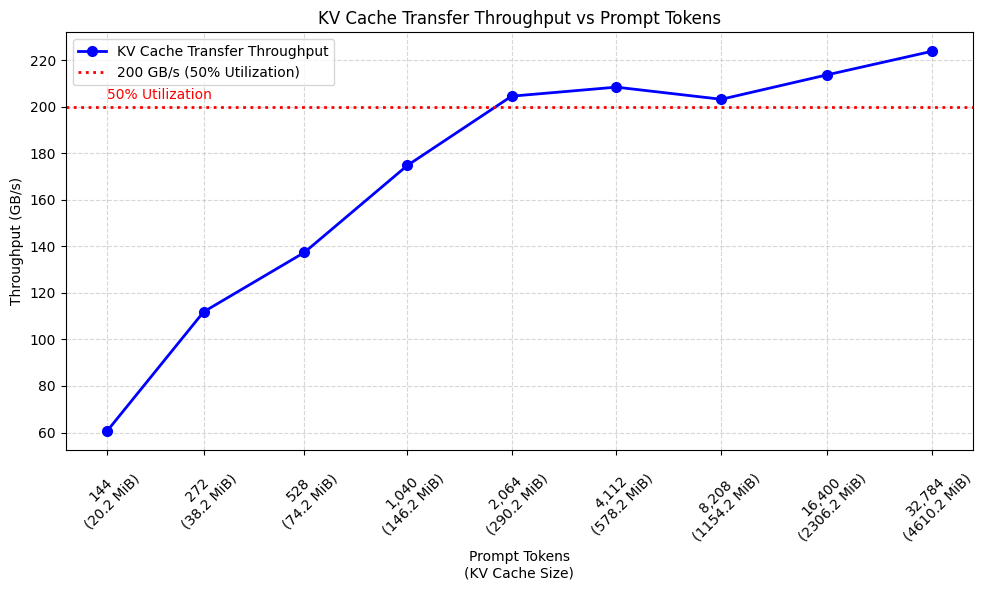
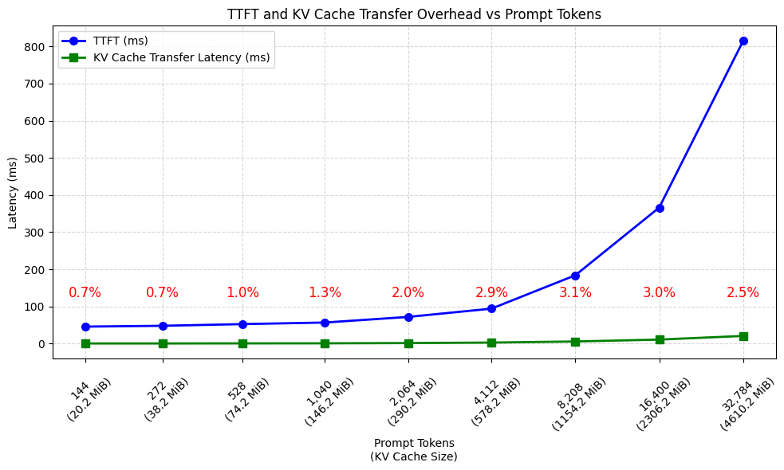
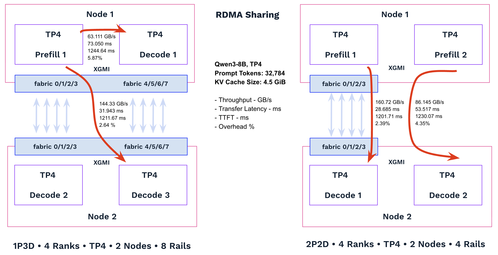

# Prefill–Decode Disaggregation with vLLM and MooncakeConnector on DOKS

Follow [amd-mn-k8s-environment](https://github.com/rxsalad/multi-node-solutions/blob/main/amd-mn-k8s-environment.MD) and [amd-mn-k8s-rdma-sharing.MD](https://github.com/rxsalad/multi-node-solutions/blob/main/amd-mn-k8s-rdma-sharing.MD) to prepare the environment before proceeding. The setup requires two DOKS workers with 16 GPUs and RDMA/RoCE support. Ensure that Multus CNI, ipvlan CNI, and Whereabouts IPAM CNI are installed and configured.

This guide provides a step-by-step walkthrough for deploying Prefill–Decode (PD) Disaggregation with vLLM and MooncakeConnector on DOKS. It leverages an RDMA sharing infrastructure to enable high-performance, low-latency KV cache transfers between prefill and decode workers, supporting 1-, 2-, 4-, and 8-GPU worker configurations in multi-node distributed deployments.

The guide also evaluates KV cache transfer performance across representative deployment scenarios, including TP1, TP4, and TP8 workloads in both intra-node and inter-node configurations, with NUMA-aligned and NUMA-misaligned GPU-to-NIC mappings. The benchmark results provide practical guidance for understanding performance characteristics and optimizing network planning and system design.

## Concepts

### Prefill–Decode Disaggregation

PD Disaggregation is an LLM serving architecture that separates the prompt processing (prefill) and token generation (decode) phases into independent worker pools. During prefill, the model processes the entire input prompt in a single forward pass, computes the hidden states for every prompt token, and constructs the key-value (KV) cache. The completed KV cache is then transferred to a decode worker, which continues autoregressive generation until the response is complete.

The two phases place fundamentally different demands on GPU hardware. **Prefill** is primarily **compute-bound** because the model performs large matrix multiplications over the entire prompt simultaneously. The abundant parallelism enables GPUs to achieve high tensor-core utilization and makes throughput largely limited by available compute resources (FLOPS). Longer prompts increase the amount of computation almost linearly, but the GPU can efficiently process many tokens in parallel.

**Decode**, in contrast, is primarily **memory-bound**. Each decoding step generates only one new token per sequence, requiring relatively little computation. However, the new token must attend to all previously generated tokens, forcing the model to repeatedly read the growing KV cache from GPU memory. As generation progresses, the KV cache becomes the dominant working set, making decode performance increasingly constrained by memory bandwidth, cache efficiency, and KV cache management rather than raw compute capability. As a result, tensor cores are often underutilized, with the GPU spending much of its time waiting on memory accesses.

Because these two phases stress different hardware resources, running them on the same GPU can lead to resource contention and inefficient scheduling. Compute-intensive prefill requests may delay latency-sensitive decode requests, while decode workloads consume memory bandwidth without fully utilizing GPU compute. By separating prefill and decode into dedicated worker pools, each can be independently optimized and scaled according to its resource profile. This improves GPU utilization, reduces request interference and tail latency, and increases overall serving throughput, provided that KV cache transfer between workers is efficient.

### vLLM and KV Connector

vLLM is a high-throughput, memory-efficient inference engine for LLMs. It maximizes GPU utilization through features such as continuous batching, tensor parallelism, quantization, speculative decoding, and distributed inference. A key innovation in vLLM is [PagedAttention](https://docs.vllm.ai/en/latest/design/paged_attention/), which manages the KV cache using a paged memory layout instead of large contiguous allocations. By storing KV data in fixed-size blocks that can be dynamically allocated and shared, PagedAttention reduces memory fragmentation, improves KV cache utilization, and enables efficient scheduling of requests with varying prompt and generation lengths. These optimizations allow vLLM to achieve higher throughput and better GPU memory efficiency than traditional LLM serving systems.

[The vLLM KV Connector](https://docs.vllm.ai/en/stable/api/vllm/distributed/kv_transfer/kv_connector/v1/) is a pluggable interface that enables KV cache transfer between vLLM processes, making PD Disaggregation practical at scale. After a prefill worker constructs the KV cache, the connector exports KV cache metadata and blocks to a decode worker, which imports them and continues autoregressive generation without recomputing the prompt.

As a higher-level abstraction for PD Disaggregation, the KV Connector manages LLM-specific KV cache operations, including KV block tracking, metadata exchange, ownership management, and transfer scheduling, while abstracting [the underlying data movement mechanisms](https://docs.vllm.ai/en/stable/features/disagg_prefill/#development). It supports [multiple connector implementations](https://docs.vllm.ai/en/stable/features/disagg_prefill/#usage-example), such as NIXLConnector, MooncakeConnector, and LMCacheConnectorV1, each using different transport backends and optimized for different deployment scenarios.

### NCCL/RCCL and vLLM KV Connector

NCCL and RCCL are low-level GPU communication libraries that provide optimized data movement between GPUs using technologies such as **NVLink/XGMI** for intra-node communication and **RDMA/RoCE** for inter-node communication. They provide communication primitives commonly used in distributed training and inference, including collective operations such as all-reduce, all-gather, and broadcast, etc.

A KV Connector implementation can support different transport backends depending on deployment requirements and system architecture. It may use NCCL/RCCL for GPU-to-GPU KV cache transfers, or leverage direct GPU communication paths such as NVLink/XGMI and RDMA/RoCE without relying on NCCL/RCCL.

Although NCCL/RCCL provide highly optimized GPU communication primitives, they are primarily designed for coordinated collective communication among predefined groups of GPUs. In contrast, KV cache transfer in PD disaggregated serving is typically a point-to-point, dynamic, and asynchronous memory transfer operation between independent prefill and decode workers. As a result, transport mechanisms optimized for direct memory movement, such as CUDA/HIP runtime API-based peer-to-peer communication (NVLink/XGMI) for intra-node transfers or RDMA-based GPU memory transport for inter-node transfers, are often better suited for this use case.

For connectors that do not use NCCL/RCCL, the connector manages its own communication stack and provides dedicated configuration parameters and environment variables to control KV cache transfer behavior, rather than relying on NCCL/RCCL-specific settings.

## vLLM Mooncake Integration

[Mooncake](https://kvcache-ai.github.io/Mooncake/design/architecture.html) is a high-performance distributed KV cache infrastructure designed for large-scale LLM serving. It enables efficient storage, sharing, and transfer of KV caches across inference workers, improving scalability, GPU utilization, and cache reuse in distributed inference deployments.

When integrated with vLLM, Mooncake supports [two primary use cases](https://github.com/kvcache-ai/Mooncake#vllm-integration-guide):

- [Disaggregated Prefill–Decode Serving](https://docs.vllm.ai/en/stable/features/mooncake_connector_usage/): Mooncake enables Prefill and Decode workers to run on separate nodes. The MooncakeConnector transfers KV cache directly between vLLM instances using high-performance RDMA-based communication, allowing compute-intensive prefill and latency-sensitive decode stages to scale independently.

- [Distributed KV Cache Storage and Sharing](https://docs.vllm.ai/en/stable/features/mooncake_store_connector_usage/): Mooncake extends the effective KV cache capacity by introducing a shared distributed cache service. Through MooncakeStoreConnector, vLLM can store and retrieve KV cache blocks from Mooncake Store, allowing multiple vLLM instances to reuse cached KV blocks via hash-based prefix caching. This improves cache hit rates and reduces redundant prefill computation.

[Mooncake Transfer Engine](https://kvcache-ai.github.io/Mooncake/design/transfer-engine/index.html) (MTE) is the underlying high-performance data transport layer used throughout the Mooncake ecosystem. It provides a unified communication abstraction for efficient KV cache movement across different components and hardware platforms.
- MooncakeConnector uses MTE to transfer KV cache directly between vLLM instances, enabling high-performance Prefill–Decode communication in disaggregated serving architectures.
- Mooncake Store uses MTE to efficiently move KV cache data between storage nodes and vLLM clients through MooncakeStoreConnector, enabling distributed KV cache storage and reuse.

MTE abstracts the underlying communication fabric and supports [multiple transport protocols](https://kvcache-ai.github.io/Mooncake/getting_started/supported-protocols.html), automatically selecting the most efficient available path, including RDMA/RoCE, NVLink/XGMI, or TCP fallback when high-performance transports are unavailable. It also enables zero-copy data movement when supported by the underlying hardware and software stack, reducing data movement overhead and improving end-to-end KV cache transfer performance.

| Component                          | Communicates With                             | Primary Responsibility                                                                                                                                                                 |
| ---------------------------------- | --------------------------------------------- | -------------------------------------------------------------------------------------------------------------------------------------------------------------------------------------- |
| **MTE** | Network, RDMA NICs, GPUs, system memory       | High-performance transport layer for KV cache movement, supporting RDMA, GPUDirect RDMA, XGMI, NVLink, TCP fallback, and zero-copy data transfers when available.                      |
| **MooncakeConnector**              | **vLLM ↔ vLLM**                               | Transfers KV cache directly between Prefill and Decode workers for disaggregated PD serving. Built on top of MTE.                                                                      |
| **MooncakeStoreConnector**         | **vLLM ↔ Mooncake Store**                     | Client-side connector that stores and retrieves KV cache objects from Mooncake Store. Uses MTE for data transfer.                                                                      |
| **Mooncake Store**                 | **vLLM clients (via MooncakeStoreConnector)** | Distributed KV cache service that stores, indexes, and serves KV cache objects, enabling cache sharing and reuse across multiple vLLM instances. Uses MTE as its data transport layer. |

**Notes:** MTE is not built on top of NCCL/RCCL. Instead, it provides its own [configuration parameters and environment variables](https://kvcache-ai.github.io/Mooncake/design/transfer-engine/index.html#advanced-runtime-options) to control transport selection, communication behavior, and performance tuning.

## Implementation Details

### Installation

Based on [the official vLLM images for AMD GPUs](https://hub.docker.com/r/vllm/vllm-openai-rocm), the Mooncake package can be installed directly from [PyPI](https://pypi.org/project/mooncake-transfer-engine-non-cuda/) following [the instructions](https://kvcache-ai.github.io/Mooncake/getting_started/quick-start.html#installation) . The package includes [all Mooncake components](https://docs.vllm.ai/en/stable/api/vllm/distributed/kv_transfer/kv_connector/v1/mooncake/), including the MTE, MooncakeConnector, MooncakeStoreConnector and Mooncake Store. For Prefill–Decode disaggregated serving with vLLM, only MTE and MooncakeConnector are used. 

``` bash
# Based image: vllm/vllm-openai-rocm:v0.21.0

pip install --no-cache-dir mooncake-transfer-engine-non-cuda==0.3.10.post2
```

### Integration 

A distributed PD disaggregation instance may consist of one Proxy instance, X Prefill (P) instances, and Y Decode (D) instances.

The P-instances and D-instances run as GPU pods based on the vLLM image with Mooncake. Each instance can be configured to use 1, 2, 4, or 8 GPUs depending on workload characteristics, and performance requirements. All GPU pods require access to a shared set of GPU fabric rails, and the number of rails can be configured from 1 to 8 based on expected traffic volume and performance targets. 

On DOKS, the GPU Device Plugin manages GPU allocation to pods, while RDMA/RoCE resource allocation and sharing are managed through the RDMA Device Plugin and Multus CNI with the ipvlan CNI plugin.

In theory, we can expose all RDMA/RoCE resources to a pod and configure MTE to use only specific RDMA/RoCE resources through [environment variables](https://kvcache-ai.github.io/Mooncake/design/transfer-engine/index.html#advanced-runtime-options) such as **MC_TE_FILTERS** and **MC_TE_FILTERS_EXCLUDE**. However, this configuration is not supported in the recent vLLM Mooncake versions used for testing, which utilizes all available RDMA/RoCE resources through automatic discovery. 

The Proxy instance can run as a CPU pod and does not require direct RDMA access. It can be based on the vLLM image and is responsible for handling incoming requests from upstream load balancers or proxies, performing request routing and scheduling, and [coordinating communication between Prefill and Decode instances](https://docs.vllm.ai/en/stable/features/disagg_prefill/#development).

The eth0 network interface within the pod is used for a variety of control-plane and data-plane operations, including user traffic, model, dataset, and library downloads/uploads, software updates, and the bootstrap, initialization, and coordination required to establish RDMA/RoCE communication paths.

Refer to [pdd/mc-pdd-1P1D1R-tp8-8rails.yaml](pdd/mc-pdd-1P1D1R-tp8-8rails.yaml) for the integration example, which provisions one proxy, one prefill instance, and one decode instance. 

The proxy pod runs the wrapper script - [pdd/mc-pdd-router.py](pdd/mc-pdd-router.py) to discover the prefill and decode pods, retrieve their IP addresses, verify that all backend instances are ready and healthy, and then start [the vLLM-provided proxy](https://github.com/vllm-project/vllm/blob/main/examples/disaggregated/mooncake_connector/mooncake_connector_proxy.py) with the discovered backends.

Both the prefill instance and the decode instance run the Qwen3-8B model with tensor parallelism (TP=8) and have access to all eight GPU fabric rails, matching the configuration used in [the official Mooncake benchmark](https://kvcache-ai.github.io/Mooncake/performance/vllm/vllm-v1-pd-performance.html).


``` bash
# Mount the proxy wrapper script into the proxy pod. 
kubectl create configmap rs-router-script --from-file=pdd/mc-pdd-router.py

kubectl describe configmap rs-router-script
kubectl delete configmap rs-router-script

kubectl apply -f pdd/mc-pdd-1P1D1R-tp8-8rails.yaml 
kubectl delete -f pdd/mc-pdd-1P1D1R-tp8-8rails.yaml
```

## How It Works

Assuming the 1P1D1R deployment is running, use kubectl exec to access the proxy pod and perform testing and benchmarking.

``` bash
# kubectl get nodes -o wide
NAME                          STATUS   ROLES    AGE   VERSION   INTERNAL-IP   EXTERNAL-IP       OS-IMAGE                       KERNEL-VERSION        CONTAINER-RUNTIME
rs-mn-cpu-power-pool-3crqkh   Ready    <none>   15d   v1.34.1   10.118.0.8    165.22.238.61     Debian GNU/Linux 13 (trixie)   6.12.48+deb13-amd64   containerd://1.7.28
rs-mn-mi325x8-pool-3cmiju     Ready    <none>   20d   v1.34.1   10.118.0.7    167.99.176.197    Debian GNU/Linux 13 (trixie)   6.12.48+deb13-amd64   containerd://1.7.28
rs-mn-mi325x8-pool-3c35jt     Ready    <none>   23d   v1.34.1   10.118.0.6    138.197.135.192   Debian GNU/Linux 13 (trixie)   6.12.48+deb13-amd64   containerd://1.7.28

# kubectl get pods -o wide
NAME               READY   STATUS    RESTARTS   AGE   IP             NODE                          NOMINATED NODE   READINESS GATES
mc-pdd-router-0    1/1     Running   0          38m   10.119.2.66    rs-mn-cpu-power-pool-3crqkh   <none>           <none>
mc-pdd-prefill-0   1/1     Running   0          38m   10.119.1.59    rs-mn-mi325x8-pool-3cmiju     <none>           <none>
mc-pdd-decode-0    1/1     Running   0          38m   10.119.0.155   rs-mn-mi325x8-pool-3c35jt     <none>           <none>

# Prefill Pod 
MC_TE_METRIC=1 \
MC_IB_PCI_RELAXED_ORDERING=1 \
MC_NUM_QP_PER_EP=4 \
MC_ENABLE_DEST_DEVICE_AFFINITY=1 \
vllm serve Qwen/Qwen3-8B \
  --no-enable-prefix-caching \
  --tensor-parallel-size 8 \
  --host 0.0.0.0 \
  --port 8010 \
  --kv-transfer-config '{"kv_connector":"MooncakeConnector","kv_role":"kv_producer"}'

# Decode Pod
MC_TE_METRIC=1 \
MC_IB_PCI_RELAXED_ORDERING=1 \
MC_NUM_QP_PER_EP=4 \
MC_ENABLE_DEST_DEVICE_AFFINITY=1 \
vllm serve Qwen/Qwen3-8B \
  --no-enable-prefix-caching \
  --tensor-parallel-size 8 \
  --host 0.0.0.0 \
  --port 8020 \
  --kv-transfer-config '{"kv_connector":"MooncakeConnector","kv_role":"kv_consumer"}'

# Proxy Pod
python /app/vllm/examples/disaggregated/mooncake_connector/mooncake_connector_proxy.py \
  --prefill http://${PREFILL_IP}:8010 \
  --decode http://${DECODE_IP}:8020 \
  --host 0.0.0.0 \
  --port 8000
```

### End-to-End Request Flow

During startup, the proxy establishes connections to the configured Prefill and Decode instances, verifies their availability through health checks, and retrieves the Prefill bootstrap information required for KV cache transfer. Prefill and Decode workers are statically configured through command-line arguments, and requests are distributed using round-robin scheduling.

The proxy serves as the request router for the disaggregated vLLM deployment by exposing OpenAI-compatible APIs and coordinating execution between independent Prefill and Decode workers. For each request, the proxy selects a Prefill worker and forwards the input prompt. After the Prefill phase completes, the worker returns **KV transfer metadata**, including the Prefill bootstrap address and transfer ID. The proxy then selects a Decode worker and forwards the request together with the kv_transfer_params, enabling the Decode worker to locate and retrieve the corresponding KV cache.

The Prefill bootstrap address acts as the control-plane endpoint for KV cache transfer. Using this information, the Decode worker's MooncakeConnector discovers the transfer metadata and coordinates retrieval of the KV cache. The proxy is not involved in the KV cache data path; it simply propagates the KV transfer metadata between the Prefill and Decode workers. The KV cache itself is transferred directly between the workers through the MooncakeConnector, while MTE provides the underlying high-performance data-plane transport.

After the transfer completes, the Decode worker imports the KV cache, reconstructs the KV block mappings, and resumes inference from the first decode step without recomputing the prompt. It then performs autoregressive decoding, incrementally extending the KV cache while streaming generated tokens back to the proxy. The proxy immediately relays the streamed responses to the client with minimal buffering, reducing end-to-end latency. Once generation finishes, the Decode worker releases the associated KV cache resources, completing the request lifecycle.

To support high concurrency, the proxy uses asynchronous HTTP communication with connection pooling for efficient request routing and response streaming.

### KV Cache Management - Size, TP Sharding, and vLLM Paging

For Qwen3-8B with TP=8, the KV cache size for a 32,768-token input sequence can be calculated from the model architecture:

```
Number of transformer layers: 36
Number of KV heads (num_key_value_heads): 8 (GQA)
Head dimension: 128
Sequence length: 32,768 tokens
KV cache data type: BF16/FP16 (2 bytes per element)
```

The KV cache size is:
```
KV cache bytes         = layers x tokens × KV heads × head dim × 2(K,V) × bytes per element
4,831,838,208 (4.5GiB)       36    32768          8        128       2                    2 
```

For tensor parallel inference with TP=8, the KV cache is sharded across TP ranks by KV heads. Since Qwen3-8B has 8 KV heads, each TP rank owns one KV head. Therefore, each GPU stores 1/8 of the total KV cache:
```
Per TP rank:
  Layer 0:  K = 8 MiB, V = 8 MiB  → 16 MiB
  Layer 1:  K = 8 MiB, V = 8 MiB  → 16 MiB
  ...
  Layer 35: K = 8 MiB, V = 8 MiB  → 16 MiB

Total: 576 MiB, 36 layers x 16 MiB per layer ( 8 MiB for K and 8 MiB for V)
```

In vLLM, the KV cache is stored using a paged KV cache layout rather than as a single contiguous tensor. The KV cache is divided into fixed-size blocks (**16 tokens per block by default**), and a block table maps logical token positions to the corresponding physical KV cache blocks in GPU memory. Therefore, the 576 MiB represents the total KV data owned by each TP rank for a 32,768-token sequence, while the actual GPU memory allocation consists of multiple paged KV cache blocks.

The KV cache for each token is sharded across the 8 TP ranks by KV heads. For each layer, the K and V values require 1 × 128 × 2 × 2 = 512 bytes per TP rank. Across 36 layers, each TP rank stores 18 KiB per token. The complete KV representation of one token across the entire TP=8 model is therefore 144 KiB, distributed across the 8 GPUs. 

### KV Cache Transfer Workflow

A request with 32,768 prompt tokens generates approximately 4.5 GiB of KV cache, evenly partitioned across the eight TP ranks. Each TP rank ([a dedicated vLLM Worker-TP process bound to a GPU](https://docs.vllm.ai/en/latest/design/arch_overview/#gpu-worker-processes)) owns a 576 MiB KV shard and transfers it to the corresponding Decode GPU. This one-to-one mapping enables all eight GPU-to-GPU KV shard transfers to proceed concurrently, maximizing aggregate transfer bandwidth.

For each transfer, MTE further partitions the 576 MiB KV shard into [64 KiB slices](https://kvcache-ai.github.io/Mooncake/design/transfer-engine/index.html#topology-aware-path-selection) (default granularity). These slices are scheduled across a pool of RDMA Queue Pairs (QPs), allowing multiple RDMA operations and worker threads to execute in parallel. This fine-grained scheduling improves transfer overlap, balances traffic across available network paths, and maximizes aggregate RDMA bandwidth.

[A Queue Pair](https://insujang.github.io/2020-02-09/introduction-to-programming-infiniband/) (QP) is the fundamental RDMA communication endpoint. Each QP consists of a Send Queue (SQ), which stores work requests describing RDMA operations (such as RDMA Write and RDMA Read), and a Receive Queue (RQ), which stores receive work requests for incoming Send messages. The actual application data remains in registered memory regions, such as GPU VRAM or host memory, while the queue entries contain only operation descriptors. A QP can access multiple registered memory regions through RDMA memory registration and the associated local and remote access keys (lkey/rkey).

Using multiple QPs over a single network rail (i.e., a local NIC–remote NIC endpoint pair) is a common optimization for improving throughput, particularly for large transfers such as KV cache migration. Multiple QPs increase the number of outstanding RDMA operations and expose additional parallelism within the NIC, enabling better utilization of PCIe, DMA, and network resources. However, the optimal number of QPs depends on the hardware configuration and workload characteristics. Creating too many QPs can increase CPU utilization, completion queue processing overhead, and memory consumption, eventually reducing overall efficiency.

Each KV transfer is managed through an MTE transfer context with associated RDMA resources, including QPs, memory registrations, and completion tracking. Multiple concurrent KV transfers can be scheduled across a shared QP pool, enabling efficient RDMA resource reuse and improving overall network utilization.

During initialization, MTE discovers available RDMA interfaces, exchanges endpoint information with remote workers, and establishes RDMA connections across the available network rails. **By default, MTE assumes a cross-rail GPU fabric and creates a full mesh of QPs between local and remote NICs.** For a system with 8 RDMA NICs on both source and destination hosts, this can create up to 64 NIC-to-NIC communication paths (8 × 8), allowing transfer slices to be distributed across multiple rails for maximum bandwidth utilization.

This default behavior can cause issues in rail-only GPU fabrics, where each NIC can communicate only with its corresponding remote NIC (for example, mlx5_0 ↔ mlx5_0). In these topologies, the full-mesh assumption can result in invalid connection attempts (for example, mlx5_0 ↔ mlx5_7). As a result, some QPs may fail to establish, causing connection timeouts and eventually leading to transfer failures.

A workaround is to expose only a single RDMA rail to all instances of a distributed application. While this approach is not ideal because it limits the available network bandwidth, it works well for some applications since a single rail still provides 400 Gbps of bandwidth.

A better solution is to enable destination device affinity using the environment variable [MC_ENABLE_DEST_DEVICE_AFFINITY](https://kvcache-ai.github.io/Mooncake/design/transfer-engine/index.html#advanced-runtime-options). When enabled, MTE matches local and remote NICs by device name (for example, mlx5_0 to mlx5_0) and establishes QPs only between valid rail pairs. This avoids invalid cross-rail connections while preserving per-rail parallelism, enabling reliable and high-performance KV cache transfers on rail-only GPU fabrics.

### Example Walkthrough

For a single request with a 32,768-token prompt sent to the proxy, the proxy routes the request to the Prefill instance, which performs prompt computation and generates the KV cache. After the Prefill phase completes, the KV cache is transferred directly from the Prefill GPUs to the corresponding Decode GPUs. The Decode instance then resumes autoregressive generation using the transferred KV cache, avoiding redundant prompt recomputation.

The KV cache is sharded across the 8 TP GPUs, with each GPU transferring a 576 MiB KV shard to its peer Decode GPU. All eight GPU-to-GPU transfers execute concurrently and complete successfully, with zero transfer failures. Each transfer achieves an average latency of 24.674 ms and an average throughput of 23,344.8 MB/s.

Collectively, the eight concurrent KV cache transfers sustain an aggregate bandwidth of approximately **186.8 GB/s (1.49 Tb/s)**, corresponding to **46.7%** of the theoretical peak bandwidth of the eight-rail interconnect.

End-to-end benchmarking reports a Time to First Token (TTFT) of **778.59 ms** for the 32,768-token prompt. The KV cache transfer contributes only **25.2 ms** of this latency, accounting for approximately **3.2% of TTFT**. This demonstrates that, for a 4.5 GiB KV cache, the transfer overhead is minimal and has a negligible impact on end-to-end inference latency.

``` bash
# Benchmarking Client - Proxy Pod

vllm bench serve --port 8000 --seed "1" \
        --backend vllm --model "Qwen/Qwen3-8B"  \
        --dataset-name random --random-input-len 32768 --random-output-len 128\
        --num-prompts 1 --burstiness 1 --request-rate 1 | tee benchmark.log

============ Serving Benchmark Result ============
Successful requests:                     1         
Failed requests:                         0         
Request rate configured (RPS):           1.00      
Benchmark duration (s):                  2.16      
Total input tokens:                      32768     
Total generated tokens:                  128       
Request throughput (req/s):              0.46      
Output token throughput (tok/s):         59.35     
Peak output token throughput (tok/s):    74.00     
Peak concurrent requests:                1.00      
Total token throughput (tok/s):          15254.06  
---------------Time to First Token----------------
Mean TTFT (ms):                          778.59    
Median TTFT (ms):                        778.59    
P99 TTFT (ms):                           778.59    
-----Time per Output Token (excl. 1st token)------
Mean TPOT (ms):                          2.96      
Median TPOT (ms):                        2.96      
P99 TPOT (ms):                           2.96      
---------------Inter-token Latency----------------
Mean ITL (ms):                           3.05      
Median ITL (ms):                         3.09      
P99 ITL (ms):                            3.55      
==================================================

# Proxy Pod

Prefill backends:
  http://10.119.1.59:8010
Decode backends:
  http://10.119.0.155:8020
Starting router: python /app/vllm/examples/disaggregated/mooncake_connector/mooncake_connector_proxy.py --prefill http://10.119.1.59:8010 --decode http://10.119.0.155:8020 --host 0.0.0.0 --port 8000
INFO:     Started server process [1]
INFO:     Waiting for application startup.
INFO:     Application startup complete.
INFO:     Uvicorn running on http://0.0.0.0:8000 (Press CTRL+C to quit)

Got 1 prefill clients and 1 decode clients.
Inited prefiller http://10.119.1.59:8010 with dp_size=1
All prefiller instances are ready.

INFO:     127.0.0.1:39160 - "POST /v1/completions HTTP/1.1" 200 OK

# Prefill Pod 
(APIServer pid=1) INFO:     Started server process [1]
(APIServer pid=1) INFO:     Waiting for application startup.
(APIServer pid=1) INFO:     Application startup complete.
(APIServer pid=1) INFO:     10.119.2.66:57498 - "GET /health HTTP/1.1" 200 OK
(APIServer pid=1) INFO:     10.119.2.66:57500 - "GET /health HTTP/1.1" 200 OK
(Worker_TP0 pid=1505) INFO:     10.119.2.66:50744 - "GET /query HTTP/1.1" 200 OK

(APIServer pid=1) INFO:     10.119.2.66:34468 - "POST /v1/completions HTTP/1.1" 200 OK

(APIServer pid=1) INFO 07-10 16:49:19 [metrics.py:103] KV Transfer metrics: Num successful transfers=8, Avg xfer time (ms)=24.674, P90 xfer time (ms)=25.204, Avg MB per transfer=576.0, Throughput (MB/s)=23344.771, Avg number of descriptors=72.0, Num failed transfers=0, Num failed recvs=0, Num KV expired reqs=0

# Decode Pod 

(APIServer pid=1) INFO:     Started server process [1]
(APIServer pid=1) INFO:     Waiting for application startup.
(APIServer pid=1) INFO:     Application startup complete.
(APIServer pid=1) INFO:     10.119.2.66:56910 - "GET /health HTTP/1.1" 200 OK

(APIServer pid=1) INFO:     10.119.2.66:38870 - "POST /v1/completions HTTP/1.1" 200 OK
```

## Benchmark - KV Cache Transnfer Performance


### Test Environment and Scripts

```
DOKS version: 1.34.1-do.2, RDMA Sharing enabled
Hardware: 2 MI325x8 nodes, with 8 × 400 Gbps Rails

Model: Qwen3-8B
vLLM version: v0.21.0
Mooncake version: 0.3.10.post2

Mooncake settings:
  MC_IB_PCI_RELAXED_ORDERING=1 
  MC_NUM_QP_PER_EP=4 
  MC_ENABLE_DEST_DEVICE_AFFINITY=1 

K8S manifest files:
  pdd/mc-pdd-1P1D1R-tp8-8rails.yaml
  pdd/mc-pdd-1P1D1R-tp8-4rails.yaml
  pdd/mc-pdd-1P1D1R-tp8-2rails.yaml
  pdd/mc-pdd-1P3D1R-tp4-8rails.yaml
  pdd/mc-pdd-1P3D1R-tp4-4rails-0123.yaml
  pdd/mc-pdd-1P3D1R-tp1-1rail-0.yaml
```

### Test 1: TP8 KV Cache Transfer Performance Scaling with Prompt Length and KV Cache Size

| Prompt Tokens | TTFT (ms) | KV Cache</BR>Transfer Latency (ms) | Overhead: </BR>Transfer Latency / FFTT | KV Cache Size (MiB) | Throughput (GB/s) | Utilization |
|--------------:|----------:|-------------------------------:|------------------------:|--------------------:|------------------:|------------:|
| 144           | 45.73     | 0.334                          | 0.7%                    | 20.248              | 60.584            | 15.1%       |
| 272           | 47.91     | 0.342                          | 0.7%                    | 38.248              | 111.883           | 28.0%       |
| 528           | 52.45     | 0.540                          | 1.0%                    | 74.248              | 137.428           | 34.4%       |
| 1040          | 56.70     | 0.736                          | 1.3%                    | 146.248             | 174.832           | 43.7%       |
| 2064          | 71.75     | 1.419                          | 2.0%                    | 290.248             | 204.577           | 51.1%       |
| 4112          | 94.11     | 2.774                          | 2.9%                    | 578.248             | 208.461           | 52.1%       |
| 8208          | 183.91    | 5.679                          | 3.1%                    | 1,154.248           | 203.244           | 50.8%       |
| 16400         | 366.19    | 10.792                         | 3.0%                    | 2,306.248           | 213.693           | 53.4%       |
| 32784         | 814.90    | 20.595                         | 2.5%                    | 4,610.240           | 223.858           | 56.0%       |

**Theoretical bandwidth:** 8 × 400 Gbps = **3.2 Tbps = 400 GB/s**  
**Utilization = Throughput / Theoretical bandwidth**

The environment and configuration are similar to those used in [the official Mooncake benchmark](https://kvcache-ai.github.io/Mooncake/performance/vllm/vllm-v1-pd-performance.html), and the measured results show comparable performance trends:

- KV cache size scales linearly with prompt length, reaching **4.5 GiB at 32,784 tokens**.
- KV cache transfer latency increases with payload size, reaching **20.595 ms** for the largest transfer of **4.5 GiB**.
- **Transfer overhead remains low**, accounting for only **0.7–3.1% of TTFT**, indicating minimal impact on end-to-end latency.
- **RDMA throughput improves with larger transfers**, reaching **223.858 GB/s** at **32,784 tokens** with **a 4.5 GiB KV cache**.
- **Large transfers achieve ~50–56% utilization** of the theoretical **400 GB/s** aggregate bandwidth.

#### KV Cache Transfer Throughput and Utilization vs Tokens



#### TTFT, KV Cache Transfer Latency and Overhead vs Tokens



### Test 2: TP1/TP4/TP8 KV Cache Transfer Performance Across Different Rail Configurations 

All benchmarks use a 32,784-token prompt, generating approximately 4.5 GiB of KV cache. Based on the measured transfer latency and throughput, we can estimate the maximum supported QPS for each configuration.


| TP | Prefill Instance | Interconnect                             | Decode Instance  | TTFT (ms) | KV Cache</BR>Transfer Latency (ms) | Overhead: </BR>Transfer Latency / FFTT | Throughput (GB/s) | Link Capacity (GB/s) | Utilization |
| -: | ---------------- | ---------------------------------------- | ---------------- | --------: | -----------------------------: | ----------------------: | ----------------: | -------------------: | ----------: |
|  8 | 8 GPUs           | 8 Rails                                  | 8 GPUs           |    814.90 |                         20.595 |               **2.53%** |           223.858 |                  400 |  **55.96%** |
|  8 | 8 GPUs           | 4 Rails (0/2/4/6)                        | 8 GPUs           |    822.12 |                         26.602 |               **3.24%** |           173.304 |                  200 |  **86.65%** |
|  8 | 8 GPUs           | 2 Rails (0/4)                            | 8 GPUs           |    847.64 |                         50.950 |               **6.01%** |            90.485 |                  100 |  **90.49%** |
|  4 | 4 GPUs (0/1/2/3) | 8 Rails                                  | 4 GPUs (0/1/2/3) |   1211.67 |                         31.943 |               **2.64%** |           144.330 |                  400 |  **36.08%** |
|  4 | 4 GPUs (0/1/2/3) | 4 Rails (0/1/2/3)</br>**NUMA Alignment**    | 4 GPUs (0/1/2/3) |   1201.71 |                         28.685 |               **2.39%** |           160.720 |                  200 |  **80.36%** |
|  4 | 4 GPUs (0/1/2/3) | 4 Rails (4/5/6/7)</br>**NUMA Misalignment** | 4 GPUs (0/1/2/3) |   1230.07 |                         53.517 |               **4.35%** |            86.145 |                  200 |  **43.07%** |
|  4 | 4 GPUs (0/1/2/3) | XGMI (Intra-node)                        | 4 GPUs (4/5/6/7) |   1244.64 |                         73.050 |               **5.87%** |            63.111 |                  512 |  **12.33%** |
|  1 | 1 GPU (0)        | 4 Rails (0/1/2/3)</br>**NUMA Alignment**    | 1 GPU (0)        |   2660.63 |                         95.424 |               **3.59%** |            48.313 |                  200 |  **24.16%** |
|  1 | 1 GPU (0)        | 1 Rail (0)</br>**NUMA Alignment**           | 1 GPU (0)        |   2666.29 |                        109.553 |               **4.11%** |            42.082 |                   50 |  **84.16%** |
|  1 | 1 GPU (0)        | 1 Rail (4)</br>**NUMA Misalignment**        | 1 GPU (0)        |   2677.88 |                        125.292 |               **4.68%** |            36.795 |                   50 |  **73.59%** |
|  1 | 1 GPU (0)        | XGMI (Intra-node)                        | 1 GPU (4)        |   2656.52 |                        112.652 |               **4.24%** |            40.925 |                  128 |  **31.97%** |

#### TP8 Workloads

Using four RDMA/RoCE rails remains an effective configuration. Despite utilizing only half of the available network bandwidth, the four-rail configuration increases KV cache transfer latency only from 20.6 ms to 26.6 ms, accounting for just 3.24% of TTFT, while achieving 86.7% link utilization.

This demonstrates that RDMA/RoCE resources can be effectively shared between CPU workloads and GPU workloads on the same node, providing greater flexibility in resource allocation.

The 2-RDMA-rail configuration achieves high link utilization (90.49%), but significantly increases KV cache transfer latency due to reduced network parallelism. Therefore, this configuration is not recommended for practical deployments.

Using 8 rails with TP4 achieves lower transfer efficiency than TP8. TP4 reaches 144.33 GB/s throughput (36.08% link utilization), compared with 223.86 GB/s (55.96% link utilization) for TP8. This demonstrates that KV cache transfer performance depends not only on available network bandwidth and communication paths, but also on GPU parallelism.

#### TP4 Workloads

For TP4 workloads, performance analysis becomes more complex because it involves both intra-node and inter-node communication paths, as well as NUMA affinity considerations.

A NUMA-aligned four-rail RDMA configuration provides the best balance between performance and network efficiency. It achieves the lowest KV cache transfer latency (28.685 ms) and the highest throughput (160.72 GB/s), while utilizing 80.36% of the available network bandwidth. However, this configuration may fragment the GPU resource pool and tightly couple workload placement with the underlying hardware topology, reducing deployment flexibility and increasing operational complexity when handling topology changes or node failures.

For example, when deploying a distributed application with a small number of instances, workloads must be placed consistently on either the GPU0–3/FABRIC0–3 group or the GPU4–7/FABRIC4–7 group to maintain NUMA alignment.

NUMA misalignment significantly impacts transfer performance. Sharing interconnect resources across two NUMA domains introduces additional latency and contention, increasing transfer latency by nearly 2× (28.7 ms → 53.5 ms) and reducing throughput from 160.7 GB/s to 86.1 GB/s. However, the impact on end-to-end inference latency remains limited, with KV cache transfer contributing only 4.35% of TTFT.

Adding additional rails without proper NUMA alignment does not necessarily improve performance. In this evaluation, the eight-rail configuration achieves lower throughput (144.3 GB/s) and lower link utilization (36.1%) compared with the NUMA-aligned four-rail configuration. This demonstrates that communication path affinity and latency can be more important than simply increasing the number of available rails.

Compared with inter-node RDMA, the intra-node XGMI configuration achieves lower KV cache transfer performance in this evaluation. Despite its higher theoretical bandwidth, measured throughput reaches only 63.1 GB/s with 12.3% utilization, indicating potential optimization opportunities in the MTE data path for intra-node transfers.



For practical TP4 deployments, two configurations can be considered: 
- Eight rails with flexible GPU/NIC placement, which improves deployment flexibility with a relatively small impact on TTFT.
- Four rails with NUMA-aligned GPU-to-NIC mappings, which provides the highest transfer performance but imposes stricter placement constraints.


#### TP1 Workloads

For TP1 workloads, a single NUMA-aligned RDMA rail provides the best balance between performance and resource efficiency. Adding additional rails increases available bandwidth but provides only marginal throughput improvements.

Similar to the TP4 results, NUMA alignment remains important for maximizing KV cache transfer efficiency. However, the overall impact on end-to-end inference latency is limited, with KV cache transfer contributing less than 5% overhead.


## Documentation and Resources 

- [RDMA Sharing Implementation for DOKS](https://github.com/rxsalad/multi-node-solutions/blob/main/amd-mn-k8s-rdma-sharing.MD)
- [Multi-Node Environment Setup and Testing for DOKS with AMD GPUs](https://github.com/rxsalad/multi-node-solutions/blob/main/amd-mn-k8s-environment.MD)

- [Mooncake: Architecture](https://kvcache-ai.github.io/Mooncake/design/architecture.html)

- [Mooncake: vLLM PD Disaggregation Performance](https://kvcache-ai.github.io/Mooncake/performance/vllm/vllm-v1-pd-performance.html)
- [Mooncake: Transfer Engine](https://kvcache-ai.github.io/Mooncake/design/transfer-engine/index.html)

- [Mooncake: vLLM Integration](https://kvcache-ai.github.io/Mooncake/getting_started/examples/vllm-integration/index.html)

- [vLLM: Disaggregated Prefilling](https://docs.vllm.ai/en/stable/features/disagg_prefill/)

- [vLLM: Paged Attention](https://docs.vllm.ai/en/latest/design/paged_attention/)

- [vLLM: MooncakeConnector Usage Guide](https://docs.vllm.ai/en/stable/features/mooncake_connector_usage/#proxy)
